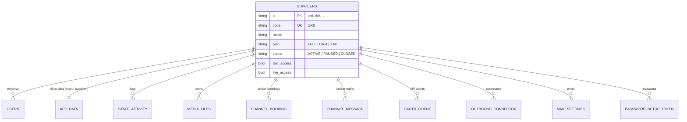

# Multi-supplier platform

One server and one PostgreSQL database serve several independent rental companies ("suppliers"). Each supplier signs in
to the same address and works only with its own data, staff, brokers, branding and files. UR-Drive Jordan (code `URD`)
is the first supplier and owns all data from before.

Status: built, tested, rehearsed on PostgreSQL. Switched off until `MULTI_SUPPLIER=true` is set on Render.

## 1. Switches (Render → NCT backend-java → Environment)

| Variable | Value | Effect |
|---|---|---|
| `MULTI_SUPPLIER` | `true` | Other suppliers can be created and used; the admin portal opens. Unset/false: UR-Drive Jordan only, exactly as before. |
| `PLATFORM_SUPER_ADMINS` | `you@example.com,…` | Accounts (of UR-Drive Jordan) allowed into `/admin`. |
| `APP_BASE_URL` | `https://www.nctrental.com` | Used in invitation and password links (already set by default). |

Turning `MULTI_SUPPLIER` off stops the other suppliers (sign-in and brokers) without deleting anything; turning it on
again brings them back as they were.

## 2. How isolation works

```
Request ──► TenantFilter (clears) ──► JwtAuthenticationFilter ──► TenantContext = supplier of the signed-in account
Broker  ──► ChannelGateway ──► ChannelStateReader.find(code) ──► TenantContext = owner of the channel (ChannelRegistry)
Job     ──► ChannelJobs / webhooks / connectors ──► TenantContext.run(owner, …) per channel
```

* The supplier always comes from the server: the account, the channel, or the job. Nothing the browser sends can set it,
  and a request can never switch supplier halfway (`TenantContext.bind` refuses a second supplier → "not found").
* Office data: one document per supplier in `app_data` (UR-Drive Jordan keeps row `main`; others `supplier-<id>`), each
  with its own hourly and before-update backups. `StateService` only ever opens the current supplier's document.
* Tables: `supplier_id` on users, activity log, files, payments, mail settings, every broker table and the table copy of
  the data. New rows are stamped automatically (`SupplierStamp`); rows from before are given `urd` on start
  (`SupplierColumnsFill`), with an index `(supplier_id, …)` on each table.
* Broker channels: channel codes and ids are unique on the platform (`ChannelRegistry`); a key works only on its own
  channel; `/api/channels/{id}/**` answers only for the signed-in supplier's channels (`ChannelOwnershipInterceptor`).
* Packages cap every permission on the server (`SupplierPlan`): Full system, CRM only, OTA XML only. Sections outside the
  package cannot be saved, even by an owner; CRM-only suppliers get no broker answers and no broker jobs.
* Nobody can give a permission they do not have themselves (`StaffAccountService.granted`).
* Support access: a super admin opens one supplier read-only for 15–120 minutes with a reason; every change is refused;
  logged in the platform log and in the supplier's own activity log.

## 3. Data model



## 4. Platform API (`/admin` uses it; super admins only, everyone else gets 404)

| Method | Path | |
|---|---|---|
| GET | `/api/platform/me` · `/overview` · `/suppliers` · `/suppliers/{id}` · `/activity` | read |
| POST | `/api/platform/suppliers` | create supplier, package, owner (invitation or first password) |
| PUT | `/api/platform/suppliers/{id}` | profile, package, test/live access |
| POST | `/api/platform/suppliers/{id}/status` | ACTIVE / PAUSED / CLOSED (reason required) |
| POST | `/api/platform/suppliers/{id}/users` · `/users/{uid}/link` · `/users/{uid}/status` | administrators |
| POST | `/api/platform/suppliers/{id}/support` | read-only support access |
| GET/POST | `/auth/password-setup` | invitation / password link (public, one-time, 72 h) |
| GET | `/auth/branding?code=XYZ` | public face of `/s/XYZ` (name, logo, colour, sign-in line) |

## 5. Roles inside a supplier

Owner, Administrator, Operations manager, Fleet manager, Reservations agent, Pricing manager, Finance user, Accountant,
Broker integration manager, Read-only — ready-made sets of the existing permissions, offered only when they fit the
package, every permission still adjustable. Platform roles (super admin) come from `PLATFORM_SUPER_ADMINS`.

## 6. Onboarding a supplier

1. `/admin` → New supplier: company (code shown to brokers), package, contacts and test/live access, owner.
2. The owner gets an invitation link (emailed with UR-Drive Jordan's email settings, or copied from the portal) and
   chooses a password.
3. The owner signs in (best via their branded link `www.nctrental.com/s/CODE`), uploads the logo in Company Details →
   Branding, adds staff with roles, fleet, branches and broker channels.
4. Brokers get the developer portal `www.nctrental.com/ota/developers?supplier=CODE` and their API key.

## 7. Go-live steps

1. Render → car-rental-db → Recovery → **Create export**, download it.
2. Push (both repositories) and let Render deploy. With `MULTI_SUPPLIER` unset nothing changes for anyone.
3. Check: sign in as usual, open a few screens, one broker search. Activity log shows normal entries.
4. Set `PLATFORM_SUPER_ADMINS` and `MULTI_SUPPLIER=true`, redeploy.
5. Open `www.nctrental.com/admin`, create a test supplier, sign in as its owner in a private window, check isolation,
   then pause or close it.

## 8. Rollback

* Switch off: `MULTI_SUPPLIER` unset → UR-Drive Jordan only; other suppliers stop, nothing is deleted.
* Previous version: Render → Deploys → redeploy the previous deploy. Rehearsed: the previous version reads the updated
  database, UR-Drive Jordan's data, staff and brokers all work; the added columns and rows are simply ignored.
* Data: the export from step 1, and the before-update copy the server keeps on every start.

## 9. Monitoring

* Admin portal → Overview: suppliers, broker calls and bookings, what needs attention (paused, live access off, inactive).
* Admin portal → Activity log: every platform action; support access highlighted.
* Each supplier's Activity log: sign-ins, changes, exports, platform support access, with IP address, browser and request id.
* Server errors are reported as before (error monitor email).

## 10. Rehearsal (PostgreSQL)

`scripts/multi-supplier/rehearsal.cjs` with `run.sh`: old version with UR-Drive data → new version on the same database
→ two suppliers with brokers → restart → rollback to the old version → switch off → switch on. 31 checks, all passing.

`scripts/multi-supplier/ui-walkthrough.cjs`, right after: a real browser on the same PostgreSQL server. The admin creates a
supplier in the wizard (sign-in address suggested and checked), the owner sets a password from the invitation, signs in at
the supplier's own address, sets branding, adds fleet and a broker channel; live broker calls are refused until the admin
switches live access on; the broker searches and books; the booking shows only in that supplier's OTA XML; support view
(read-only, logged on both sides); address change; pause and reactivate; platform activity log; UR-Drive Jordan unchanged.
27 checks, all passing.

## 11. Not included (by decision)

Redis, Kafka/RabbitMQ (one server), Apache CXF (SOAP already works), custom domains per supplier, virus scanning of
uploads. Payment links stay a UR-Drive Jordan feature.
